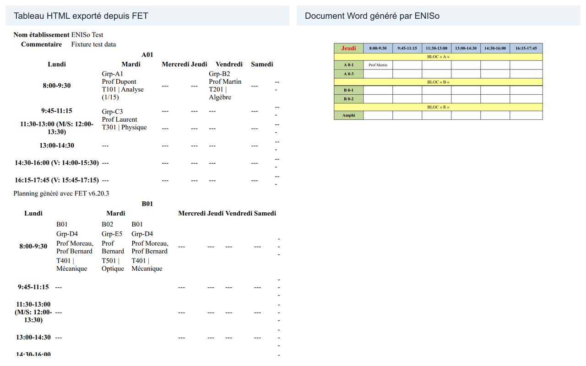

# Guide d’utilisation d’ENISo

## Démarrage rapide

1. Ouvrez **[Importer]** et choisissez un ou plusieurs fichiers HTML exportés depuis FET.
2. Vérifiez l’aperçu de l’emploi du temps et les fichiers reconnus.
3. Choisissez un jour, puis sélectionnez **[Télécharger le document du jour]** ou **[Tous les jours (.zip)]**.
4. Dans l’application de bureau, utilisez **[Enregistrer dans un dossier…]** pour choisir un dossier.
5. Résultat attendu : un document Word par jour, ou une archive ZIP avec les documents disponibles.
6. Vous pouvez importer seulement le fichier HTML des salles.
7. Les fichiers des enseignants et des groupes complètent les informations disponibles.
8. Les options du document Word s’appliquent aux prochains téléchargements.
9. Les corrections dans **[Noms]** s’appliquent à tous les emplois du temps de cette base.
10. Ouvrez **[Aide]** dans l’application pour retrouver ce guide hors connexion.

## À quoi sert l’application

ENISo transforme un emploi du temps HTML exporté depuis FET en documents Word. Vous pouvez consulter les séances par jour et télécharger un document pour chaque journée. L’application regroupe les salles par bloc.



## Installer l’application

### Télécharger et ouvrir l’application

1. Téléchargez le fichier d’installation fourni par votre établissement. Son nom se termine par `.exe` sous Windows.
2. Ouvrez le fichier et suivez les étapes affichées par l’installateur.
3. Si Windows affiche « Windows a protégé votre ordinateur », sélectionnez « Informations complémentaires », puis « Exécuter quand même ».
4. Ce message apparaît parce que l’application n’est pas signée par un certificat de signature de code. Il ne signifie pas que Windows a détecté un problème dans le fichier.
5. Une fois l’installation terminée, ouvrez **[Emplois du temps ENISo]** depuis le raccourci du Bureau.

L’installateur place l’application dans le dossier choisi pendant l’installation. Le dossier proposé par défaut est celui des applications de votre compte Windows. Le raccourci du Bureau s’appelle **[Emplois du temps ENISo]**.

**Résultat attendu :** la fenêtre **[Emplois du temps]** s’ouvre et affiche l’écran d’import.

### Vérifier le fichier téléchargé (facultatif)

Vous pouvez vérifier que le fichier téléchargé correspond à celui publié. Sur la page de la version GitHub, relevez la somme SHA-256 associée au nom du fichier dans la section « Sommes SHA-256 » ou dans le fichier joint `SHA256SUMS.txt`. Ouvrez PowerShell dans le dossier qui contient le fichier, puis exécutez :

```powershell
Get-FileHash .\<fichier> -Algorithm SHA256
```

Comparez la valeur affichée après `Hash` avec la somme publiée pour le même nom de fichier. Si les valeurs diffèrent, ne poursuivez pas l’installation et téléchargez à nouveau le fichier depuis la source prévue par votre établissement.

**Résultat attendu :** la valeur `Hash` est identique à la somme SHA-256 publiée pour le fichier vérifié.

## Ouvrir l’aide dans l’application

Sélectionnez **[Aide]**, puis **[Guide d’utilisation]** dans le menu de l’application. La touche **[F1]** ouvre aussi le guide. Pour garder une copie imprimable, sélectionnez **[Enregistrer le guide en PDF…]**. Le menu **[À propos]** indique le nom, la version et le dossier des données.

**Résultat attendu :** le guide s’ouvre dans la fenêtre ENISo ou un fichier PDF est enregistré à l’emplacement choisi.

Si « Le guide PDF n’a pas pu être enregistré » apparaît, vérifiez que le dossier choisi existe et qu’il reste de l’espace libre, puis réessayez.

## Premier démarrage et import des fichiers

### Importer les fichiers HTML

FET peut produire des fichiers dont le nom contient `rooms`, `teachers` ou `groups`. Dans l’application, ces types apparaissent comme **[Salles]**, **[Enseignants]** et **[Groupes]**. Le fichier des salles suffit pour créer les documents Word. Les deux autres fichiers apportent des informations complémentaires.

Si « Type de fichier inconnu » apparaît, vérifiez que le nom du fichier contient l’un des types attendus : `rooms`, `teachers` ou `groups`. Le message précise « attendu : teachers, rooms ou groups dans le nom ».

Les étapes exactes pour produire les trois fichiers dans FET et choisir l’affichage des jours à l’horizontale restent **à confirmer** par le responsable du projet.

1. Ouvrez **[Importer]**.
2. Déposez les fichiers HTML dans la zone **[Glissez les fichiers HTML ici ou cliquez pour les choisir]**, ou cliquez sur cette zone et sélectionnez les fichiers.
3. Vérifiez l’étiquette de type affichée devant chaque nom de fichier. **[Type ?]** signifie que l’application ne reconnaît pas le type dans le nom.
4. Si vous créez un nouvel emploi du temps, vous pouvez saisir un nom dans **[Nom (facultatif) — ex. S1 2026-2027]**.
5. Sélectionnez **[Importer]**.

**Résultat attendu :** l’emploi du temps apparaît dans la liste et son aperçu s’ouvre. Les types de fichiers reçus sont indiqués sous son nom.

### Ajouter ou remplacer un fichier

1. Ouvrez l’emploi du temps concerné.
2. Sélectionnez **[Ajouter / remplacer des fichiers]**.
3. Choisissez le nouveau fichier HTML du type à ajouter ou remplacer.
4. Sélectionnez **[Importer]**.

**Résultat attendu :** le type choisi est ajouté ou remplacé dans cet emploi du temps.

## Aperçu et téléchargement

### Consulter un jour et télécharger les documents

1. Sélectionnez un jour dans les onglets des jours disponibles.
2. Vérifiez les salles, les blocs et les séances de l’aperçu.
3. Pour télécharger le jour affiché, sélectionnez **[Télécharger le document du jour]**. Le nom du jour s’adapte à l’onglet choisi.
4. Pour télécharger tous les jours dans une archive, sélectionnez **[Tous les jours (.zip)]**.
5. Dans l’application de bureau, sélectionnez **[Enregistrer dans un dossier…]**, puis choisissez un dossier.

Le téléchargement du navigateur est enregistré dans le dossier habituellement utilisé pour les téléchargements. Pour l’enregistrement dans un dossier, l’application écrit les fichiers dans le dossier choisi et l’ouvre ensuite dans l’explorateur.

**Résultat attendu :** vous obtenez un fichier `.docx` pour le jour affiché, une archive `.zip`, ou un document Word par jour dans le dossier sélectionné.

## Options du document Word

### Choisir un profil d’export

Un **profil** est un ensemble nommé d’options du document Word. Le profil actif s’applique à l’aperçu et à tous les téléchargements (jour, archive ZIP et dossier).

1. Dans l’onglet **[Emploi du temps]**, ouvrez **[Options du document Word]**.
2. Dans **[Profils d’export]**, choisissez le profil à modifier dans la liste.
3. Utilisez **[renommer]**, **[définir par défaut]** ou **[supprimer]** pour gérer le profil sélectionné.
4. Pour créer une variante, saisissez un nom dans le champ à côté de **[+ nouveau profil]** puis sélectionnez ce bouton. Le nouveau profil copie les options du profil actif.

**Résultat attendu :** le profil choisi est utilisé pour l’aperçu et les prochains documents. Le profil par défaut est utilisé quand aucun profil n’est explicitement sélectionné.

### Régler le contenu des cellules

Le contenu de chaque case peut être composé de plusieurs lignes : enseignant, groupe et matière.

1. Dans **[Contenu des cellules]**, choisissez un préréglage ou personnalisez le **[Modèle de cellule]**.
2. Les préréglages proposés sont : enseignant seul, enseignant + groupe, enseignant + groupe + matière, et groupe + matière.
3. Le modèle accepte les jetons `{teacher}`, `{group}`, `{subjectCode}`, `{subject}` et `{frequency}`. Un saut de ligne dans le modèle crée une ligne dans la cellule.
4. Réglez **[Affichage de la matière]** (nom complet, code ou code + nom), **[Longueur max du nom]**, **[Séparateur de groupes]**, **[Taille de police des cellules]**, et les options **[Italique]** / **[Taille réduite]** pour les lignes secondaires.

**Résultat attendu :** les cases de l’aperçu et du document Word affichent les lignes configurées.

### Régler la mise en page et les pages

Vous pouvez répartir les blocs sur plusieurs pages et changer l’orientation du document.

1. Dans **[Mise en page]**, choisissez **[Portrait]** ou **[Paysage]**.
2. Activez **[Répéter l’en-tête du jour sur chaque page]** pour réafficher le nom du jour et les horaires en haut de chaque page.
3. Activez **[Afficher un titre de page]** pour afficher les noms des blocs au-dessus de chaque tableau.
4. Dans le tableau **[Blocs et pages]**, assignez chaque bloc à une page avec la liste **[Page]**. Les blocs d’une même page sont imprimés ensemble ; chaque page devient une section du document Word.

**Résultat attendu :** le document Word est découpé en sections selon les pages configurées, avec l’orientation et les en-têtes choisis.

### Régler les blocs et leurs expressions

Les blocs regroupent les salles dans des bandes du document Word. Par exemple, si le bloc A contient les salles A01, A02 et A12, son expression peut commencer par `^A\d\d`. Le signe `^` signifie « au début du nom » et `\d\d` signifie « deux chiffres ».

Le champ des expressions accepte plusieurs règles séparées par des virgules. Vous pouvez copier une des expressions suivantes :

- `^A\d\d` : salles dont le nom commence par A suivi de deux chiffres.
- `^B\d\d` : salles dont le nom commence par B suivi de deux chiffres.
- `^R|^Amphi` : salles dont le nom commence par R ou par Amphi.

1. Ouvrez **[Options du document Word]**.
2. Dans la ligne du bloc, modifiez son titre ou ses expressions.
3. Utilisez une virgule pour séparer plusieurs expressions dans le même champ.
4. Utilisez **[+ ajouter un bloc]** pour créer une ligne ou **[supprimer]** pour retirer une ligne.
5. Sélectionnez **[Enregistrer]**.

**Résultat attendu :** les salles correspondantes sont regroupées sous le titre du bloc dans le prochain aperçu ou document Word.

### Options générales

1. Activez **[Abréger « BEN » en « B » (ex. B Rhouma Asma)]** pour raccourcir ce préfixe dans les noms affichés.
2. Activez **[Afficher « 1/15 » pour les séances une semaine sur deux]** pour afficher cette indication de fréquence.
3. Activez **[Lister aussi les salles libres]** pour inclure les salles sans séance.
4. Modifiez **[Libellé de la pause]** pour choisir le texte affiché dans les créneaux de pause vides.
5. Sélectionnez **[Enregistrer]**.

**Résultat attendu :** le message **[Options enregistrées]** apparaît. Les prochains aperçus et documents utilisent ces options.

## Noms et libellés

### Corriger les noms affichés

1. Sélectionnez **[Noms]**.
2. Dans **[Affiché dans Word]**, saisissez le nom ou le libellé souhaité. Vous pouvez rechercher une entrée avec **[Rechercher]**.
3. Répétez l’opération pour les enseignants ou les salles à corriger.
4. Sélectionnez **[Enregistrer]** dans la barre des modifications.

Les corrections s’appliquent à tous les emplois du temps de cette base. Elles ne modifient pas les fichiers HTML importés. Pour revenir au nom automatique d’une entrée, utilisez le bouton de réinitialisation sur sa ligne, puis enregistrez.

**Résultat attendu :** le message **[Noms enregistrés]** apparaît et les prochains documents utilisent les corrections.

### Sauvegarder ou importer les corrections

1. Pour garder une copie des corrections, sélectionnez **[Exporter les noms (.json)]**.
2. Pour ajouter des corrections depuis une copie, sélectionnez **[Importer des noms…]** et choisissez le fichier JSON.

**Résultat attendu :** le navigateur télécharge `noms-enis.json` à l’export, ou affiche le bilan de l’import.

## Mises à jour

### Vérifier et installer une mise à jour

Sur Windows et Linux AppImage, l’application installée vérifie les mises à jour en arrière-plan. Sur les autres systèmes, la recherche automatique n’est pas disponible. Quand une mise à jour est téléchargée, vous pouvez choisir **[Redémarrer pour installer]** ou **[Plus tard]**. Vous pouvez aussi ouvrir le menu **[Fichier]** et choisir **[Rechercher des mises à jour…]**.

1. Enregistrez votre travail dans l’application.
2. Sélectionnez **[Rechercher des mises à jour…]** dans le menu **[Fichier]**.
3. Si une mise à jour est prête, sélectionnez **[Redémarrer pour installer]** pour l’installer maintenant, ou **[Plus tard]** pour attendre la prochaine fermeture.

**Résultat attendu :** l’application installe la mise à jour au redémarrage choisi. Une connexion Internet est nécessaire pour rechercher et télécharger une mise à jour. Si la dernière version est déjà installée, l’application l’indique.

## Comparer deux versions

### Importer une nouvelle version

Quand un emploi du temps est réédité (nouvelle période, séances déplacées, salles changées), importez les nouveaux fichiers HTML en choisissant la version précédente dans le champ **[Nouvelle version de…]** de l’écran d’import. Le champ propose les emplois du temps déjà importés ; laissez **[— Aucun (première version) —]** pour un premier import. Après l’import, l’onglet **[Changements]** s’ouvre pour comparer les deux versions.

Ce champ n’est disponible qu’à la création d’un emploi du temps : il ne peut pas être combiné avec **[Ajouter / remplacer des fichiers]**. Le message « « Nouvelle version de… » ne peut être utilisé qu’à la création d’un emploi du temps » apparaît si les deux options sont demandées ensemble. Si le message « Version précédente introuvable » ou « Version précédente invalide » apparaît, rechargez la liste des emplois du temps et choisissez à nouveau la version de base.

### Lire les changements

L’onglet **[Changements]** compare la version affichée avec une version de base choisie dans **[Comparer avec]**. Par défaut, la version précédente déclarée à l’import est pré-sélectionnée. Le sélecteur **[Vue]** choisit la source de comparaison : **[Automatique]** utilise les enseignants si les deux versions les ont, sinon les salles, sinon les groupes.

Chaque changement est classé par type : **[Ajoutée]**, **[Supprimée]**, **[Déplacée]**, **[Salle changée]**, **[Groupe changé]** ou **[Enseignant changé]**. Pour chaque entrée, l’application affiche le jour, l’horaire et la salle avant et après la modification. Les filtres **[Tous les types]**, **[Enseignant]**, **[Salle]**, **[Tous les jours]** et **[Rechercher…]** permettent de réduire la liste ; **[Afficher plus]** charge les changements suivants par lots.

La liste **[Jours à rééditer]** indique les jours dont le document Word change : ce sont les fichiers à régénérer et à réimprimer. Si aucun changement n’existe, le message « Aucun changement entre ces deux versions. » s’affiche. Si plus de la moitié des séances diffèrent, le bandeau « Ces deux emplois du temps semblent très différents » avertit que les deux versions sont peut-être sans rapport.

### Exporter la fiche des changements

Les boutons **[Exporter la fiche (.docx)]** et **[Exporter (.csv)]** produisent un document récapitulatif : la fiche Word contient le résumé, les jours à rééditer et le détail des changements ; le CSV contient une ligne par changement, lisible dans un tableur.

### Surligner les changements dans l’aperçu

Depuis l’onglet **[Emploi du temps]**, activez **[Surligner les changements]** pour mettre en évidence dans la grille les cellules qui diffèrent entre les deux versions comparées. Le surlignage est purement visuel : il n’apparaît pas dans les documents Word exportés.

### Limites de la comparaison

La comparaison rapproche les séances par leur identité (enseignants, groupe, matière, horaire et salle). Une séance dont plusieurs attributs changent en même temps peut apparaître comme une suppression suivie d’un ajout plutôt que comme un déplacement. Un groupe renommé n’est reconnu comme **[Groupe changé]** que si tout le reste est identique : enseignant, matière (code et intitulé), horaire, salle et fréquence. Sinon la séance apparaît comme supprimée puis ajoutée. Les messages « Les deux emplois du temps ne partagent aucune vue commune (teachers/rooms/groups) », « Source de comparaison invalide : … (attendu : auto, teachers, rooms ou groups) », « La vue … est absente de l’un des deux emplois du temps » et « Impossible de comparer un emploi du temps avec lui-même » signalent une comparaison impossible.

## Vos données et sauvegardes

### Retrouver vos données

Sous Windows, les données sont conservées dans le dossier utilisateur de l’application : `%APPDATA%\Emplois du temps ENISo`. La base se trouve dans le sous-dossier `database`. Les sauvegardes automatiques se trouvent dans `backups` et les journaux de mise à jour dans `logs`.

La désinstallation ne supprime pas ces données. Lors d’une mise à jour, l’application crée une copie de la base avant de démarrer la nouvelle version. Elle conserve les deux sauvegardes les plus récentes. Si une sauvegarde échoue, l’application affiche un avertissement et continue : « L’application continue, mais vérifiez vos données avant de poursuivre. »

1. Ouvrez le menu **[Fichier]**.
2. Sélectionnez **[Ouvrir le dossier des sauvegardes]**.
3. Copiez le dossier de sauvegarde vers un emplacement sûr.

**Résultat attendu :** l’explorateur de fichiers affiche le dossier `backups`.

### Déplacer les corrections vers un autre ordinateur

1. Sur le premier ordinateur, sélectionnez **[Noms]**, puis **[Exporter les noms (.json)]**.
2. Transférez le fichier `noms-enis.json` par le moyen autorisé par votre établissement.
3. Sur l’autre ordinateur, sélectionnez **[Noms]**, puis **[Importer des noms…]** et choisissez ce fichier.

**Résultat attendu :** les corrections de noms sont importées sur l’autre ordinateur. Cet export ne contient pas les emplois du temps ni la base de données.

## Sauvegarder et restaurer vos données

L’écran **[Sauvegardes et restauration]**, accessible depuis le lien **[Sauvegardes]** dans le bas du volet latéral ou par le menu **[Fichier]**, vous permet de créer des sauvegardes complètes, de régler les sauvegardes automatiques et de restaurer vos données en toute sécurité.

### Créer une sauvegarde manuelle

1. Ouvrez **[Sauvegardes]**.
2. Sélectionnez **[Créer une sauvegarde maintenant]**.
3. Le navigateur ou l’application télécharge un fichier d’archive `.enisbackup` contenant tous les emplois du temps, les séances, les corrections de noms et les paramètres.
4. Conservez ce fichier sur une clé USB ou un dossier cloud sécurisé.

**Résultat attendu :** une archive de sauvegarde `.enisbackup` complète est téléchargée.

### Configurer les sauvegardes automatiques

L’application crée automatiquement une sauvegarde au démarrage si la plus récente date de plus de 24 heures, ainsi que 30 secondes après la dernière modification des données (le délai étant réinitialisé à chaque nouveau changement).

1. Dans la section **[Sauvegardes automatiques]**, activez **[Activer les sauvegardes automatiques]**.
2. Modifiez le champ **[Rétention (3 à 50) :]** pour définir le nombre de sauvegardes à conserver.
3. Sélectionnez **[Enregistrer les paramètres]**.
4. Dans le tableau des sauvegardes automatiques, vous pouvez sélectionner **[Télécharger]** pour récupérer un fichier, **[Restaurer]** pour l’analyser, ou **[Supprimer]** pour retirer une sauvegarde.

**Résultat attendu :** les paramètres sont enregistrés et les anciennes sauvegardes au-delà de la limite sont automatiquement élaguées.

### Restaurer une sauvegarde

La restauration inspecte d’abord le fichier sans modifier vos données et crée une sauvegarde de sécurité avant toute modification.

1. Dans **[Restaurer des données]**, déposez un fichier dans la zone de dépôt ou choisissez **[Restaurer]** sur une sauvegarde automatique.
2. Vérifiez la fiche d’analyse affichée.
3. Choisissez le mode souhaité :
   - **[Remplacer toutes les données]** : efface les données actuelles et les remplace intégralement. Cochez obligatoirement **[Je confirme vouloir remplacer toutes les données actuelles]**.
   - **[Ajouter les emplois du temps de la sauvegarde]** : conserve vos données et ajoute les nouveaux emplois du temps sous de nouveaux identifiants.
4. Sélectionnez **[Restaurer les données]** pour exécuter la restauration, ou **[Annuler]** pour fermer.
5. En cas de succès, sélectionnez **[Retourner aux emplois du temps]** ou **[← Retour aux emplois du temps]**.

**Résultat attendu :** les données sont restaurées dans une transaction unique. En cas de problème, tout est annulé immédiatement et aucune donnée n’est modifiée.

### Sauvegardes de mise à jour (avancé)

Avant chaque mise à jour, l’application tente de copier la base de données dans un dossier `database-...`. Cette sauvegarde physique pré-mise à jour s’effectue au mieux (best-effort) : en cas d’échec de la copie, le démarrage n’est pas bloqué et un avertissement s’affiche au lancement. Dans la section **[Sauvegardes de mise à jour (avancé)]**, sélectionnez **[Ouvrir le dossier]** pour afficher son contenu.

## Problèmes fréquents

### Fichier non reconnu ou import refusé

- « Type de fichier inconnu » : le nom du fichier ne contient pas `rooms`, `teachers`, `groups`, `salle`, `enseignant` ou `group`. Vérifiez que vous avez choisi un fichier HTML exporté depuis FET.
- « Deux fichiers du même type (teachers/rooms/groups) ont été envoyés » : sélectionnez un seul fichier par type. Vous pouvez ajouter ou remplacer un fichier ensuite.
- « Aucun fichier HTML reçu » : sélectionnez au moins un fichier avant de lancer l’import.
- « ne contient aucun tableau d'emploi du temps » : le fichier ne contient pas de tableau reconnu. Vérifiez le fichier exporté.
- « Emploi du temps introuvable » : l’emploi du temps demandé n’est plus dans la base. Revenez à la liste et sélectionnez un emploi du temps existant.
- « Cet emploi du temps ne contient aucune donnée » : aucun fichier importé ne fournit de séances. Importez un fichier HTML de salles.
- « Jour invalide » : rechargez l’emploi du temps et choisissez l’un des jours affichés.
- « Options invalides » : une option enregistrée n’est pas reconnue. Rouvrez les options, corrigez la valeur signalée et enregistrez-la de nouveau.
- « Le nom affiché doit être un texte ou vide », « le nom affiché dépasse 60 caractères » ou « le nom affiché contient un caractère de contrôle » : corrigez le nom dans l’onglet **[Noms]**. Un nom affiché peut contenir jusqu’à 60 caractères.
- « Clé de nom invalide » : la correction ne correspond pas à un nom reconnu dans la base. Rechargez la page avant de réessayer.
- « Dossier invalide » : choisissez un dossier existant et accessible.

### Sauvegarde ou restauration refusée

- « Fichier de sauvegarde vide ou manquant » : fournissez un fichier non vide.
- « L’archive de sauvegarde dépasse la taille maximale autorisée (200 Mo) » : l’archive dépasse la limite maximale fixée pour des raisons de sécurité.
- « Le fichier sélectionné n’est pas une archive ZIP valide » : le fichier n’est pas un ZIP ou est endommagé.
- « L’archive de sauvegarde est vide » : l’archive ne contient aucun fichier.
- « L’archive contient un nombre d’entrées anormal » : l’archive contient plus de fichiers que prévu.
- « L’archive contient des chemins de fichiers interdits (tentative d’évasion) » : l’archive contient des noms de chemins suspects.
- « Dossier inattendu dans l’archive » ou « L’archive contient un fichier inattendu ou non reconnu » : l’archive contient des fichiers non prévus.
- « L’archive ne contient pas de fichier manifest.json », « Le fichier manifest.json est corrompu ou n’est pas un JSON valide », « Le fichier manifest.json est incomplet ou malformé » ou « Le fichier manifest.json dépasse la taille maximale autorisée » : le manifeste obligatoire est absent ou incorrect.
- « Format d’archive non pris en charge (format v » : l’archive utilise une version de format inconnue.
- « Version de schéma de sauvegarde non valide » : la valeur du schéma dans le manifeste est incorrecte. Utilisez une archive valide non corrompue ou recréez la sauvegarde.
- « Cette sauvegarde a été créée avec une version plus récente de l’application (schéma v … ). Mettez à jour l’application pour pouvoir la restaurer » : installez la version la plus récente de l’application.
- « Compte invalide dans le manifeste pour la table » : le nombre de lignes déclaré est erroné.
- « Fichier de données manquant dans l’archive » ou « Fichier de données obligatoire manquant dans l’archive » : une table attendue est absente.
- « Le volume décompressé de l’archive dépasse la limite autorisée », « Ratio de compression anormal détecté (protection anti zip-bomb) » ou « Erreur lors de la lecture de l’archive » : l’archive dépasse les seuils de sécurité de décompression ou est illisible.
- « Somme de contrôle manquante dans le manifeste pour » ou « Somme de contrôle (SHA-256) invalide pour le fichier … . L’archive est corrompue ou a été modifiée » : l’intégrité des fichiers n’a pas pu être vérifiée.
- « Nombre de lignes incohérent pour la table », « Ligne … invalide dans … : JSON malformé », « date de création invalide », « date de modification invalide », « format du créneau » ou « Clé de paramètre en doublon détectée dans l’archive » : les données de l’archive ne respectent pas le schéma attendu.
- « L’archive contient une séance orpheline (ligne … ) faisant référence à un emploi du temps inexistant » ou « Séance orpheline détectée pour l’emploi du temps « … ». Restauration interrompue » : une séance fait référence à un emploi du temps absent.
- « Mode de restauration non valide. Les modes autorisés sont « replace » ou « merge » » : choisissez un mode de restauration valide.
- « Impossible de créer la sauvegarde de sécurité préalable. La restauration a été annulée et aucune donnée n’a été modifiée » : la création de la sauvegarde de sécurité a échoué.
- « Incohérence détectée après restauration (emplois du temps: … , séances: … ). Annulation » : les données insérées ne correspondent pas au manifeste, la transaction a été annulée.
- « Identifiant de sauvegarde invalide » ou « Sauvegarde introuvable » : la sauvegarde demandée n’existe pas dans le dossier.
- « Aucun fichier ou identifiant fourni pour l’inspection », « Fichier de restauration temporaire expiré ou introuvable. Veuillez réessayer » ou « Identifiant ou jeton de restauration manquant » : relancez l’analyse ou choisissez une sauvegarde.
- « Restauration en cours. L’application est temporairement en maintenance. Veuillez patienter » : une restauration est en train de modifier la base.
- « Une opération de sauvegarde ou de restauration est déjà en cours » : attendez la fin de l’opération en cours.

### Une salle est vide ou une case manque

Vérifiez que le fichier des salles correspond à la bonne période et qu’il s’agit de l’export HTML avec les jours disposés à l’horizontale. L’expression du bloc peut aussi exclure une salle. Les étapes exactes de production dans FET restent à confirmer.

### L’application ne démarre pas ou signale une erreur de base de données

La fenêtre « Démarrage impossible » indique que le serveur de l’application ou la base de données n’a pas démarré. Fermez les autres fenêtres ENISo et réessayez. Si vous avez configuré une base de données externe, vérifiez qu’elle est démarrée et que son adresse est correcte dans le fichier de configuration.

Les messages possibles comprennent « La base de données intégrée n'a pas pu démarrer », « La connexion à PostgreSQL a échoué », « Le fichier de version PostgreSQL est vide ou corrompu » et « Les données n’ont pas été modifiées ». En cas de version PostgreSQL incompatible, restaurez une sauvegarde compatible ou contactez le support.

### L’antivirus affiche un avertissement

L’installateur Windows n’est pas signé par un certificat de signature de code. Windows peut afficher son avertissement SmartScreen. Suivez l’étape « Informations complémentaires », puis « Exécuter quand même » si vous avez reçu le fichier d’installation de la source prévue par votre établissement.

### La police Word est différente ou un jour ne contient pas de séance

Word peut afficher une police de remplacement si la police du document n’est pas installée sur l’ordinateur. Le document reste lisible, mais sa mise en page peut légèrement différer. Si un jour ne contient aucune séance, l’aperçu peut être vide pour ce jour : vérifiez les autres onglets et les fichiers importés.

### Le fichier de corrections de noms est refusé

Le fichier JSON doit provenir de **[Exporter les noms (.json)]**. Les messages « Fichier de noms invalide », « Fichier de noms invalide : objet attendu », « Fichier de noms invalide : version ou listes manquantes », « Le fichier de noms dépasse 1 Mo », « Le champ « items » doit être une liste » et « La liste contient trop de lignes » signalent un fichier incorrect ou trop volumineux.

Les erreurs qui commencent par « Ligne » indiquent l’entrée à corriger : « objet attendu », « le nom dans le fichier est obligatoire », « le nom dans le fichier est invalide », « le nom affiché est obligatoire dans un fichier importé » ou « ce nom apparaît plusieurs fois ». Exportez à nouveau les noms depuis un fichier valide, ou corrigez l’entrée indiquée avant de réessayer.

### Une mise à jour ou le serveur ne répond pas

Si la recherche affiche « La recherche de mises à jour a échoué », vérifiez la connexion Internet et réessayez plus tard. Si « La mise à jour n’a pas pu être installée » apparaît, fermez l’application puis relancez-la. Si « Impossible d’ouvrir la page des versions » apparaît, ouvrez la page des versions depuis un navigateur.

Si « La mise à jour automatique n’est pas disponible sur cette plateforme » apparaît, l’application peut proposer d’ouvrir la page des versions. Si « La recherche de mises à jour est disponible uniquement dans une version installée » ou « Les mises à jour automatiques sont désactivées dans le fichier de configuration » apparaît, utilisez la version installée ou contactez la personne qui gère l’application.

Les messages « Le serveur ne répond pas » et « Le serveur s’est arrêté au démarrage » signalent un problème de démarrage. Fermez les autres fenêtres ENISo puis relancez l’application. Si « Le serveur intégré n’a pas pu être arrêté proprement » apparaît, choisissez **[Réessayer]**. Pour un message détaillé, contactez la personne qui vous a fourni l’application.

Si une mise à jour indique « La version … est prête. Redémarrer maintenant pour l’installer ? », sélectionnez **[Redémarrer maintenant]** pour l’installer ou **[Plus tard]** pour attendre.

Si le message « Le serveur intégré n’a pas pu être arrêté proprement. Vous pouvez réessayer ou quitter quand même » apparaît, sélectionnez **[Réessayer]**. Si l’application indique que « Le processus API ne répond pas à l’arrêt », « Le processus API ne s’est pas arrêté après SIGKILL » ou « Impossible d’arrêter le processus API », fermez les autres fenêtres ENISo puis relancez l’application.

## Glossaire

- **Emploi du temps** : organisation des séances par jour et par horaire.
- **Séance** : activité prévue à un horaire, dans une salle, avec un enseignant ou un groupe.
- **Salle** : lieu où se déroule une séance.
- **Bloc** : groupe de salles présenté dans une même bande du document Word.
- **Fichier HTML** : fichier de page Web exporté depuis FET et lu par l’application.
- **Document Word** : fichier `.docx` que vous pouvez ouvrir ou imprimer dans un logiciel de traitement de texte.
- **Archive ZIP** : fichier qui rassemble les documents de plusieurs jours.
- **Libellé** : texte affiché pour une salle, une pause ou un autre élément.
- **Sauvegarde** : copie de données conservée pour pouvoir les récupérer.
